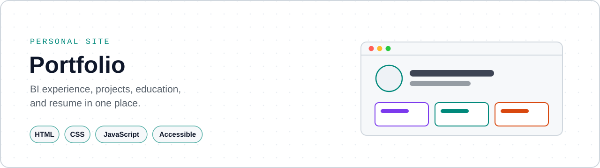

<picture>
  <source media="(prefers-color-scheme: dark)" srcset="assets/banner-dark.svg">
  
</picture>

# Ashwin Pillanda Ravindra · Portfolio

Source for [ashwinpr15.github.io](https://ashwinpr15.github.io/): my BI experience at TCS, case studies, MSBA studies at BU Questrom, skills and resume.

Hand-written HTML, CSS and a little JavaScript. No framework, no build step.

## Pages

| URL | Page |
| --- | --- |
| `/` | Hero, case studies, other projects, experience, education and skills, contact |
| `/work/fleet-sales-reporting/` | Case study: fleet sales reporting automation |
| `/work/qlikview-power-bi-migration/` | Case study: QlikView to Power BI migration |
| `/work/f1-cost-cap/` | Case study: Formula 1 cost cap and competitive balance |
| `/work/headset-desk/` | Headset Desk |
| `/work/quadruped-robot/` | Quadruped robot capstone |
| `/404.html` | Not-found page |

## How it's built

- Every page is static HTML with its own title, description, canonical URL and social preview tags, so each case study can be opened, reloaded and shared directly.
- All content is visible without JavaScript. `script.js` only adds the theme toggle and the "Copy email" button.
- Light and dark themes follow the system setting, with a manual toggle that is remembered.
- Inter is self-hosted from `assets/fonts/` (SIL Open Font License), so the site makes no third-party requests.
- Images have fixed dimensions and responsive sizes; `assets/social-card.png` is the 1200 × 630 link preview.

## Local preview

```sh
python3 -m http.server 8123
```

Then open http://localhost:8123.

## Checks

```sh
npm install
npx playwright install chromium
npm run check
```

`npm run check` validates the HTML and runs the Playwright tests in `tests/`: every page loads, internal links and images resolve, pages work with JavaScript off, there is no sideways scrolling from 320 to 1440 px, and axe finds no accessibility violations in either theme. The same checks run in GitHub Actions on pushes and pull requests.

## Files

| Path | Purpose |
| --- | --- |
| `index.html` | Home page |
| `work/*/index.html` | Case-study and project pages |
| `styles.css` | Design tokens, layout, themes and responsive rules |
| `script.js` | Theme toggle and copy-email button |
| `assets/work/` | Case-study charts, diagrams and screenshots |
| `assets/img/` | Resized portrait and card images |
| `assets/Ashwin-Resume.pdf` | Resume |
| `robots.txt`, `sitemap.xml` | Search engine files |
| `tests/`, `playwright.config.js`, `.htmlvalidate.json` | Site checks |

## Credits

- F1 charts come from the [BA780 F1 Cost Cap](https://github.com/ashwinpr15/BA780-F1-Cost-Cap) team notebook; data from [F1DB](https://github.com/f1db/f1db) (CC BY 4.0).
- [Inter](https://github.com/rsms/inter) by The Inter Project Authors, SIL Open Font License 1.1.
